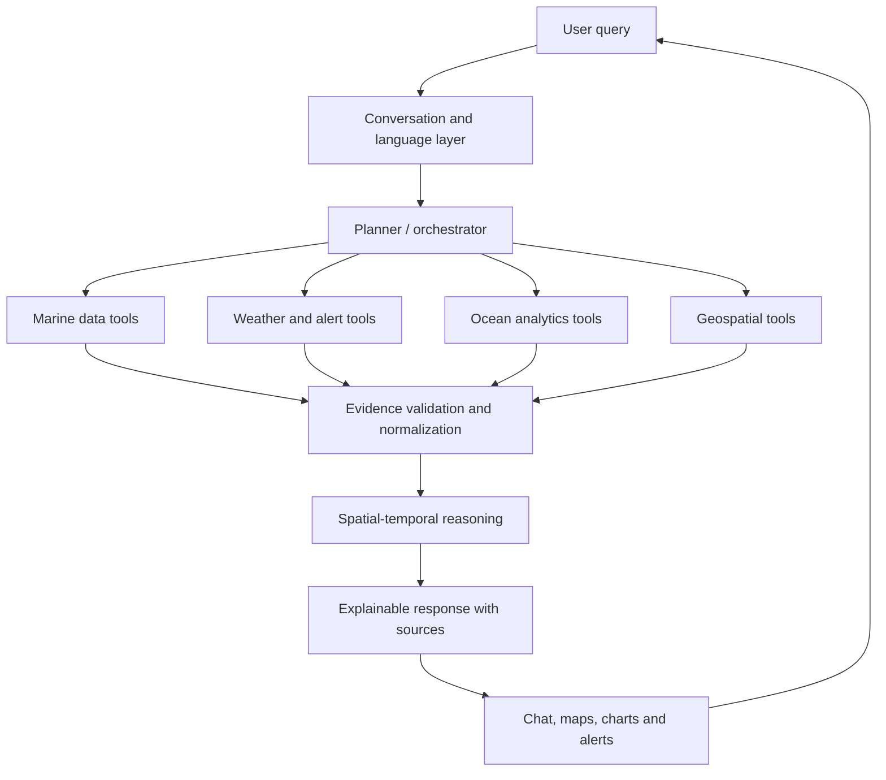

# ORCA — Marine Ecosystem Reasoning with Collaborative Agents

**Smart India Hackathon 2026 · Problem Statement: SIH26176 · Organization: ISRO · Team: CodeNova**

ORCA is a proposed Agentic AI-powered marine intelligence and decision-support platform. It is designed to help fishermen and other marine stakeholders explore satellite Earth Observation, oceanographic, meteorological and geospatial information through natural-language conversations and evidence-based explanations.

> **Project status: Planning / documentation starter.** This repository currently contains the project concept, design documentation and SIH idea-presentation PDF. The application, agents, live data connectors, risk models, maps, alerts and route planner are **planned**, not implemented or operational. Do not interpret the proposed capabilities as available services.

## 1. Problem

Marine users often need to consult multiple sources to understand fishing potential and changing sea conditions. ORCA proposes a conversational interface that can coordinate specialist tools, correlate relevant data for a location and time, and explain the evidence behind its responses.

Example questions the planned platform aims to support:

- Where is the nearest Potential Fishing Zone (PFZ) today?
- What are the weather, tide and sea conditions near my fishing location?
- Are there official cyclone, lightning or other marine alerts for this area?
- Which areas show potentially favourable sea-surface temperature and chlorophyll conditions?
- Which areas should be avoided because of hazards or restricted boundaries?

## 2. Proposed capabilities

- Natural-language queries and contextual, multi-turn conversations.
- Automatic language identification, with a planned focus on Indian regional languages.
- Agent planning, task decomposition and specialist-tool coordination.
- Retrieval of relevant marine, satellite, weather and geospatial information.
- Spatial and temporal analysis with source, timestamp and data-quality context.
- Evidence-backed summaries, maps, charts and alerts.
- Planned geofencing and hazard-aware route analysis, subject to authoritative data and validation.

## 3. Proposed agent roles

| Role | Planned responsibility |
|---|---|
| Conversation & language | Understand user intent, language and conversation context |
| Planner / orchestrator | Break a request into tasks and select specialist tools |
| Marine data | Retrieve PFZ and relevant satellite/ocean observations |
| Weather & alerts | Retrieve forecasts and official weather/marine warnings |
| Ocean analytics | Analyze available waves, currents, tides and sea-state products |
| Geospatial | Handle coordinates, distance, spatial filters and boundaries |
| Risk & reasoning | Combine validated evidence into a transparent assessment |
| Visualization & response | Present maps, charts, sources and conversational explanations |

These are logical roles. The design may use one orchestrator with modular agents/tools; it does not require a separate LLM for every role.

## 4. Proposed workflow



See [`architecture/architecture.md`](architecture/architecture.md) for design details.

## 5. Candidate technology stack

These are options for implementation, not technologies already integrated in this repository.

| Area | Candidate technologies |
|---|---|
| Language | Python |
| Backend API | FastAPI |
| Prototype UI | Streamlit; React is an alternative for a richer frontend |
| Agent orchestration | LangGraph or a lightweight custom orchestrator |
| Data processing | Pandas, NumPy, xarray |
| Geospatial | GeoPandas, Shapely, Rasterio |
| Spatial database | PostgreSQL + PostGIS |
| Maps | Leaflet or MapLibre |
| Machine learning | Scikit-learn, only where a validated model is justified |

## 6. Repository layout

```text
ORCA-Marine-Intelligence-Platform/
├── README.md
├── CONTRIBUTING.md
├── .gitignore
├── architecture/          # Proposed system design and agent workflow
├── data/                  # Data policy and future sample fixtures
├── docs/                  # SIH presentation, data-source notes and roadmap
├── src/                   # Reserved for future application implementation
│   ├── agents/
│   ├── api/
│   ├── data/
│   ├── geospatial/
│   ├── reasoning/
│   └── visualization/
└── tests/                 # Reserved for future automated tests
```

## 7. Development status

| Component | Status |
|---|---|
| Problem understanding and idea presentation | Documented |
| Proposed architecture and agent responsibilities | Documented; implementation planned |
| Data-source investigation | Candidate sources documented; access not yet verified |
| Backend and conversational interface | Planned |
| Live satellite / marine / weather integrations | Planned; not connected |
| Geospatial map and spatial reasoning | Planned |
| Risk assessment and alerts | Planned; requires validated rules and authoritative feeds |
| Route planning and geofencing | Planned; requires suitable data and safety validation |
| Automated tests | Planned |

## 8. Safety, trust and data quality

- Display provider, product, retrieval time, valid time, units and spatial coverage for important evidence.
- Clearly distinguish observed, forecast, derived and AI-generated information.
- Never treat missing, stale or failed data as evidence that conditions are safe.
- Do not present an experimental score as an official warning or certified navigation instruction.
- Defer to current official advisories and local authorities for safety-critical decisions. ORCA is intended as decision support, not a replacement for them.
- Do not suggest a route unless required data, restrictions and validation are available.

## 9. Getting started

This is currently a documentation and project-planning repository. There is no runnable application or installation command yet. Implementation instructions will be added when the first working software module is committed.

## 10. Documents

- [SIH26176 idea presentation (PDF)](docs/SIH26176_ORCA_Idea_Presentation.pdf)
- [System architecture](architecture/architecture.md)
- [Candidate data sources and checks](docs/data-sources.md)
- [Implementation roadmap](docs/implementation-roadmap.md)
- [Data and safety policy](data/README.md)
- [Contribution guidelines](CONTRIBUTING.md)

## Team

**CodeNova** · Smart India Hackathon 2026 · **SIH26176**
