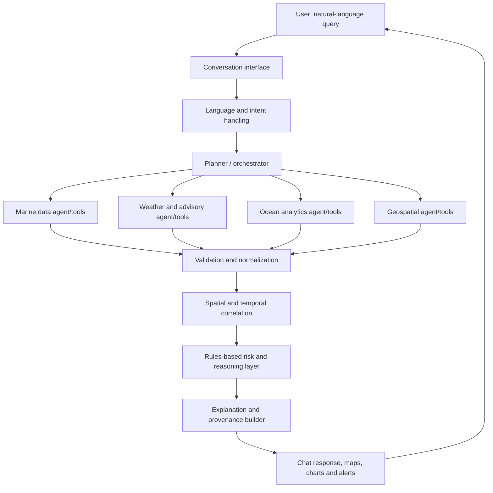

# ORCA proposed system architecture

> **Status: Design proposal.** This document describes the intended architecture. No live agents, connectors or operational decisions are implemented by this documentation alone.

## Design goals

1. Interpret a user's question, location and time window.
2. Plan a set of bounded data-retrieval and analysis tasks.
3. Coordinate specialist modules and collect their outputs.
4. Normalize evidence before combining it.
5. Produce a traceable explanation with source and freshness information.
6. Clearly report uncertainty, missing data and unavailable services.

## High-level flow



## Logical components

| Component | Inputs | Planned outputs |
|---|---|---|
| Conversation / language | User text, conversation context | Intent, language, entities and clarifying questions |
| Planner / orchestrator | Structured intent | Task plan, selected tools, execution trace |
| Marine data tools | Location and time | PFZ / satellite / ocean product observations where available |
| Weather and advisory tools | Area and valid-time window | Forecasts and official warning records |
| Ocean analytics tools | Marine datasets | Normalized sea-state, tide or current indicators where available |
| Geospatial tools | Coordinates, geometries, boundary layers | Distances, intersections, spatial filters and map features |
| Validation / normalization | Raw provider responses | Typed values, units, timestamps, provenance and quality flags |
| Reasoning / risk | Validated evidence and versioned rules | Explainable assessment, limitations and evidence references |
| Presentation | Structured result | Natural-language response, map layers and charts |

## Suggested evidence record

The following is a **proposed schema example**, not a real observation:

```json
{
  "parameter": "wave_height",
  "value": null,
  "unit": "m",
  "location": {"latitude": null, "longitude": null},
  "observed_at": null,
  "valid_from": null,
  "valid_to": null,
  "provider": null,
  "product": null,
  "source_reference": null,
  "quality_status": "unavailable"
}
```

A result should preserve provider metadata and distinguish observation time from forecast valid time. Missing values must remain missing; they must not be silently replaced with zero or interpreted as safe conditions.

## Agent coordination principles

- Use one orchestrator to create and track a task plan.
- Give each specialist a narrow responsibility and typed input/output contract.
- Run independent retrieval tasks concurrently where practical.
- Validate tool outputs before reasoning over them.
- Keep a trace of which tools ran, which failed and which evidence supported the final response.
- Ask the user for clarification when location or time is insufficient.

## Safety and failure handling

- Stale feed: mark stale and show the last update; do not infer current conditions.
- Missing feed: show unavailable and reduce the scope of any conclusion.
- Conflicting feeds: preserve both values, compare source metadata and avoid false certainty.
- Hazard advisory: show issuer, issue time, validity period and official source link.
- Route planning: do not return a route unless authoritative hazard and restriction layers, route constraints and validation are available.

## Implementation sequence

Start with one narrow end-to-end workflow, such as retrieving a documented marine advisory for a selected location and time. Add agent roles only when they provide a clear, testable responsibility. See [`../docs/implementation-roadmap.md`](../docs/implementation-roadmap.md).
